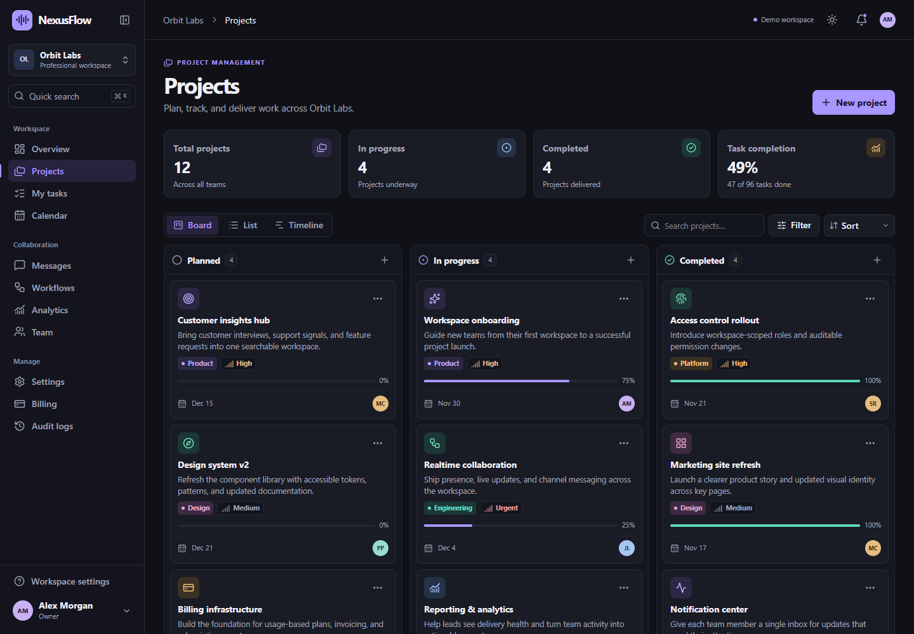
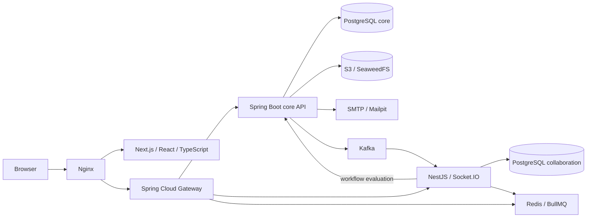

# NexusFlow

NexusFlow gives each team a private workspace to plan projects, see what shipped, chat, and automate routine updates. In the walkthrough, completing a task triggers a real notification and creates an execution record.

[Try the public demo](https://ankush-48.github.io/NexusFlow/) · [Watch the 23-second walkthrough](docs/demo.webm) · [Read the engineering case study](docs/portfolio.md)

[](docs/demo.webm)

[Messaging screenshot](docs/screenshots/messages.png) · [Workflow builder screenshot](docs/screenshots/workflows.png) · [Implementation and verification status](IMPLEMENTATION_STATUS.md)

## Quick preview

Install [Node.js 24](https://nodejs.org/) and run these commands from the repository root.

```bash
npm ci
npm run demo
```

Open [localhost:3000](http://127.0.0.1:3000). The preview opens the Orbit Labs board with example projects and messages. It stores changes in the current browser and is designed for trying the interface without infrastructure.

If port 3000 is in use, run `npm run demo -- --port 3100` and open that port. In the preview, open **Workspace onboarding**, create a task, move it to **Completed**, then check **Notifications** and **Workflows → Executions**.

The public demo opens with sample data and stores edits in the visitor's browser. To rebuild its static files locally after installing dependencies, run `npm run build:portfolio`. Serve the generated `apps/web/out` directory with any static HTTPS host.

## Release verification

The complete stack verified tenant isolation, real-time messaging, and workflow delivery. A 13-minute local HTTPS test processed 2,172 requests across 12 sessions and three workspaces with zero failures and a 39.87 ms p95. Separate restart drills verified Kafka delivery and Redis recovery, and the database restore matched every row in the test backups.

[Load measurements](docs/benchmarks.md) · [Deployment verification](docs/deployment-validation.md) · [Security review](docs/security-review.md) · [Database recovery drill](docs/database-recovery.md)

## Full local workspace

Install Node.js 24 and Docker with the Compose plugin. Generate a unique set of local secrets, then build the stack.

```bash
node scripts/init-env.mjs --demo
docker compose up --build --wait
```

- Workspace and API gateway at [localhost:3000](http://localhost:3000)
- Swagger UI at [localhost:3000/swagger-ui.html](http://localhost:3000/swagger-ui.html)
- Local verification and reset emails at [localhost:8025](http://localhost:8025)
- Optional Prometheus and Grafana via `docker compose --profile observability up -d`. Grafana listens on port 3010 and reads its password from `.env`.

The application writes its state to PostgreSQL, Redis, Kafka and SeaweedFS volumes. Stop the containers with `docker compose down`. The data volumes persist.

Earlier releases used MinIO for local task attachments. SeaweedFS uses a new volume and retains the existing credential variable names. If your workspace already has MinIO attachments, copy the objects from its `nexusflow` bucket to the same bucket and keys in SeaweedFS using an authenticated S3 client, then verify a download before switching users over. Keep the old volume until verification is complete. AWS deployments use S3 directly.

### Demo accounts

With the `--demo` flag, the generator writes a unique `NEXUS_DEMO_PASSWORD` to `.env` and enables the demo fixtures. All six demo users share that generated local password. Use seed flags only with a dedicated demo database.

| Account | Scope |
| --- | --- |
| `alex@orbit.example` | Workspace owner and platform administrator. Can switch among three organizations. |
| `sam@orbit.example` | Orbit Labs administrator |
| `maya@orbit.example` | Orbit Labs project manager |
| `jordan@orbit.example` | Orbit Labs team member |
| `noah@orbit.example` | Orbit Labs viewer |

The fixture contains 15 projects, 120 tasks, dated delivery history, and examples of channel messages and workflow rules. To see a workflow run, complete a task in an Orbit Labs project, wait for the event to process, then open the execution history. The project owner receives the default completion notification.

### Environment

| Variable | Purpose |
| --- | --- |
| `NEXUS_ORIGIN`, `NEXUS_PORT` | Browser origin and local ingress port. Keep these aligned. |
| `NEXUS_SECURE_COOKIES` | Enable secure cookies behind HTTPS. |
| `NEXUS_VERIFY_EMAIL` | Require email verification at signup. Disable only for a disposable test stack. |
| `POSTGRES_ADMIN_PASSWORD`, `CORE_DB_PASSWORD`, `REALTIME_DB_PASSWORD` | PostgreSQL bootstrap and isolated service credentials |
| `NEXUS_WORKER_SECRET` | Private shared secret for worker-to-core requests |
| `MINIO_ROOT_USER`, `MINIO_ROOT_PASSWORD` | Local S3-compatible storage credentials |
| `NEXUS_DEMO_PASSWORD`, `NEXUS_SEED_COLLAB` | Opt-in seed credentials and collaboration fixtures |
| `NEXUS_BILLING_MODE` | `mock`, `stripe-test`, or `disabled` |
| `STRIPE_SECRET_KEY`, `STRIPE_WEBHOOK_SECRET`, `STRIPE_PRO_PRICE`, `STRIPE_ENTERPRISE_PRICE` | Optional Stripe test billing configuration |

For Stripe test mode, configure a recurring test price per paid plan and allow subscription changes in the Stripe test customer portal. Forward the three `customer.subscription.*` events listed in the [API notes](docs/architecture/api.md) to the webhook. Test fixtures and the local mock billing flow can run without Stripe credentials.

### Send verification emails to real inboxes

Set the public HTTPS URL in `NEXUS_ORIGIN` and set `NEXUS_SECURE_COOKIES=true`. In the local `.env` file, set `SMTP_HOST`, `SMTP_PORT`, `SMTP_USERNAME`, `SMTP_PASSWORD`, and `SMTP_FROM` using a verified sender and an authenticated STARTTLS SMTP account. The default SMTP port is 587. Keep the sender credential in the ignored `.env` file.

Run the same Compose project with the SMTP override:

```bash
docker compose -f docker-compose.yml -f docker-compose.smtp.yml up -d --wait
```

New signup and password reset messages go to the email address provided by the user. Users with an unverified account can choose **Resend verification email** on the sign-in page. Use the SMTP override on subsequent updates to preserve the email configuration.

## Architecture



Java owns identity, policy, projects, tasks, billing, and workflow definitions. Spring validates tenant access and applies business changes and outbox events in a single PostgreSQL transaction. Node.js owns conversation state, WebSocket sessions, and worker concurrency. NestJS delegates identity and workspace authorization to Java, so permission policy has one authoritative source. The data stores have separate credentials in Compose.

[High-level design](docs/architecture/HLD.md) · [Low-level design](docs/architecture/LLD.md) · [ER diagram](docs/architecture/database.md) · [API notes](docs/architecture/api.md)

## Test and build

```bash
npm run lint --workspace @nexusflow/web
npm run check
npm run test --workspaces
npm run build
mvn -f services/core-api/pom.xml verify
mvn -f services/api-gateway/pom.xml verify
npx playwright install chromium
npm run e2e --workspace @nexusflow/web
```

Run `npm run test:integration` against a disposable live stack configured with `NEXUS_VERIFY_EMAIL=false`. Set `NEXUS_TEST_URL` to the browser origin when it differs from the default. Set `NEXUS_TEST_WORKFLOWS=1` and `NEXUS_TEST_ATTACHMENTS=1` to exercise the worker and object-storage paths. To run the live Playwright test, set `NEXUS_E2E_URL` to the live origin and `NEXUS_LIVE_E2E=1`.

[Benchmark results and reproduction commands](docs/benchmarks.md) · [Known limits and verification scope](IMPLEMENTATION_STATUS.md)

## AWS and source publishing

The Terraform configuration defines an HTTPS ALB, an EC2 target, private RDS subnets, and an encrypted private S3 bucket. The AWS Compose override uses managed PostgreSQL and S3 while running application services, Kafka, and Redis on the instance. See the [AWS runbook](docs/aws.md) for configuration and release steps.

To publish the code, initialize Git from the extracted project root, commit the source, and push it to a repository you own. Review the staged files before committing. Environment files and runtime state are ignored.

```bash
git init -b main
git add .
git status --short
git commit -m "Add NexusFlow workspace platform"
git remote add origin YOUR_REPOSITORY_URL
git push -u origin main
```

## Attribution

The [Next.js SaaS Starter](https://github.com/nextjs/saas-starter) informed the organization, account, and billing flows. See [third-party notices](THIRD_PARTY_NOTICES.md) and the [MIT license](LICENSE).
