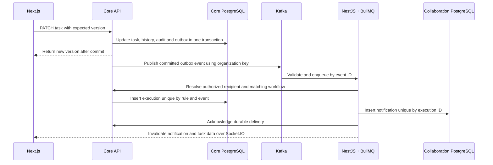

# High-level design

NexusFlow serves an organization-scoped workspace. A user can belong to several organizations with different roles. A workspace ID is an API routing value. The services independently verify the actor's membership before querying tenant data.

| Service | Owns | Main dependencies |
| --- | --- | --- |
| Next.js | Workspace UI, preview adapter and browser query cache | React, TanStack Query, Zustand, Recharts, React Hook Form |
| Spring Cloud Gateway | Routing, origin policy, request correlation and throttling | Redis |
| Spring Boot | Identity, roles, projects, tasks, directories, billing, workflow definitions and audit events | Core PostgreSQL, Kafka, SMTP, S3 |
| NestJS | Conversations, notifications, Socket.IO rooms and asynchronous workers | Collaboration PostgreSQL, Redis, Kafka, Core REST |
| Nginx | Same-origin ingress and WebSocket upgrade forwarding | Gateway, Next.js |

## Event delivery

The observer can see a committed task before it sees the notification. Outbox delivery is at least once. Execution and notification identifiers make duplicate processing safe for database records. Queue retention is bounded, and the database uniqueness constraints still apply after job retention expires.

## Trade-offs

- Use Java where transactional consistency and auditable policy decisions dominate. Use Node.js where long-lived connections and concurrent I/O dominate.
- Use synchronous REST for interactive writes and tenant checks. Use Kafka for fan-out after a transaction commits.
- Use explicit SQL for tenant-scoped joins and aggregates, with JPA for a scoped task existence query and schema validation. Task writes use a version predicate in SQL.
- Redis provides the ingress request counter, cross-instance Socket.IO adapter, and job storage. TanStack Query caches browser reads by workspace and invalidates them on writes and events.
- PostgreSQL account checks occur on request and socket room entry. Periodic socket membership validation bounds the open-room revocation window. Scope-sensitive payloads are loaded by HTTP after a socket invalidation.
- Docker Compose favors a reproducible single-host setup. Shared Redis and Kafka are still single points of failure in that topology.
