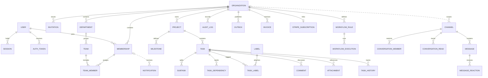

# Database ownership and relationships

The core schema is versioned by Flyway in `services/core-api/src/main/resources/db/migration`. The collaboration service applies additive schema setup inside an advisory-locked startup transaction. Dashed business references between core IDs and collaboration data are checked through REST.

The core schema indexes tenant and project IDs, due dates, owner assignments, pending outbox rows, and report ordering. The collaboration database indexes messages by workspace, conversation, and creation date. Combined tenant/record foreign keys prevent a valid ID in another workspace from becoming an accidental reference.
