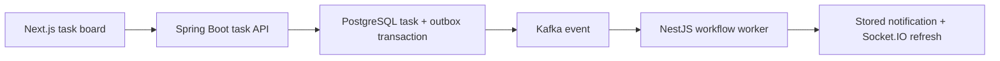

# NexusFlow engineering case study

Teams can plan work on a board or timeline, coordinate in private conversations, and automate notifications from task activity. Each organization has its own membership, roles and data. Try the workflow in a browser with sample data, or watch a recording of the same flow through Kafka and PostgreSQL. [Try the public demo](undefined) · [Watch the recording](demo.webm)

## Three implementation decisions

| Problem | Implementation | Evidence |
| --- | --- | --- |
| Two people move the same task | Each write carries the version it read. PostgreSQL serializes competing writes, and the stale update returns HTTP 409 so the UI can refresh. | [API integration tests](../tests/integration/api.mjs) |
| Kafka stops after a task is saved | The task change and its outbox event commit in one database transaction. A background publisher retries delivery. Workflow execution and notification records use stable identifiers so replay can be reconciled. | [Kafka restart drill](benchmarks/broker-recovery.json) |
| A user tries to open another team's data | The Java API checks membership and scopes relational queries by organization. The realtime service rechecks workspace and conversation access before joining Socket.IO rooms. | [Security review](security-review.md) |

## Follow one request

The most revealing debug story happened during HTTPS testing. The browser could load the app and call the API, but Spring Cloud Gateway rejected the WebSocket upgrade because it received HTTP behind Nginx. The fix configured the exact public origin for WebSocket handshakes. A browser test then observed an authenticated presence event over WSS. [Deployment evidence](deployment-validation.md)

## Measured results

- A 13-minute local HTTPS run completed 2,172 requests across 12 sessions and three workspaces with zero failed requests. The p95 was 39.87 ms. [Raw benchmark](benchmarks/soak.json)
- Stopping Kafka left three accepted task writes readable. Restarting delivered three successful workflow runs and three unique notifications. [Recovery test](../tests/load/broker-recovery.mjs)
- Both PostgreSQL test backups were restored to a separate instance. The restore matched 432 rows across 35 tables. [Restore procedure](database-recovery.md)

The current deployment template uses one application host. Hosted staging, full container execution and an independent security review remain open. [Release status](../IMPLEMENTATION_STATUS.md)

## Résumé wording

Use wording that reflects your contribution and the areas you can explain in an interview.

> Developed NexusFlow, a multi-tenant workspace for projects, real-time chat and workflow automation using Next.js, Spring Boot, PostgreSQL, Kafka and Redis. Validated tenant isolation and event recovery, and ran a 2,172-request local HTTPS test with zero failures.
